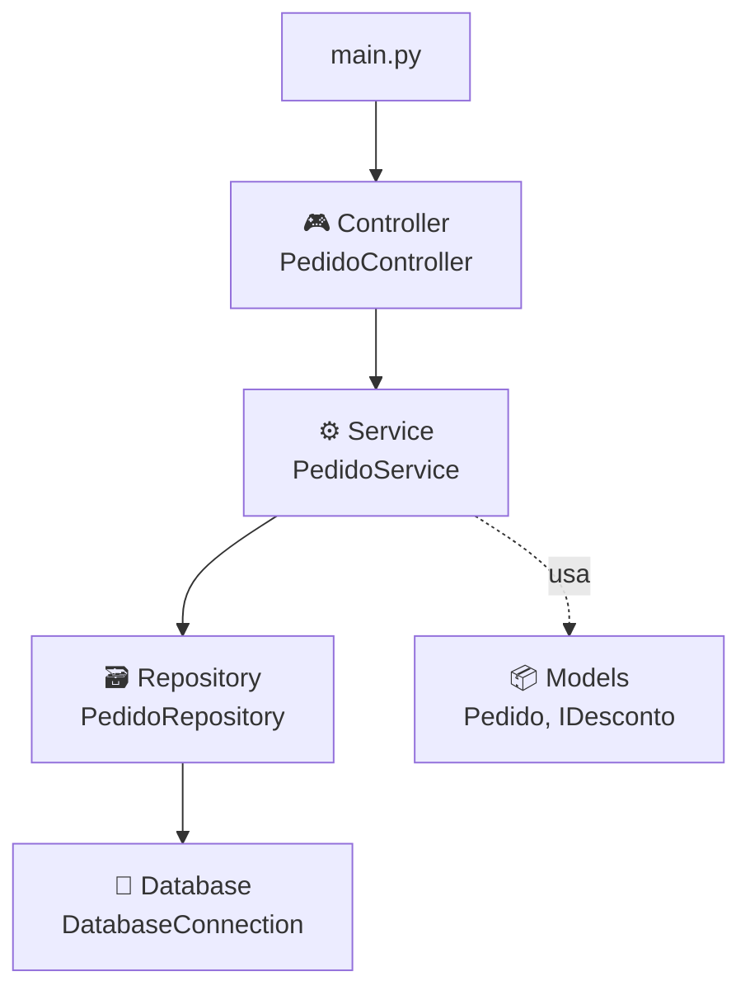
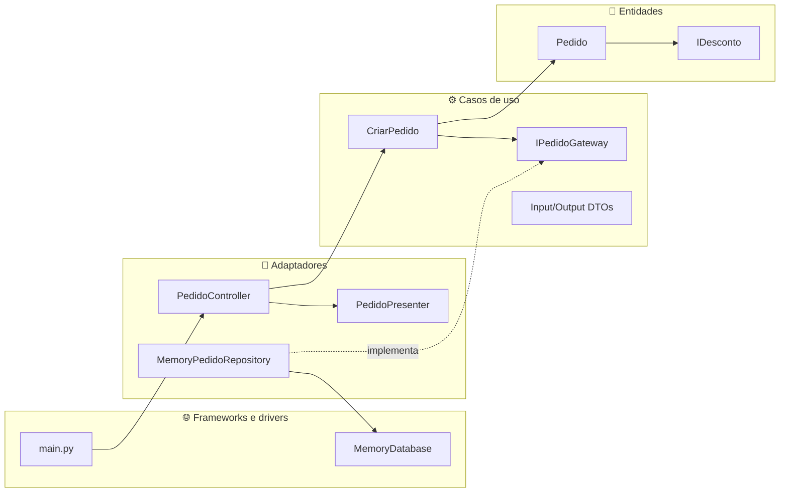
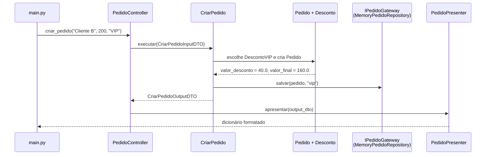
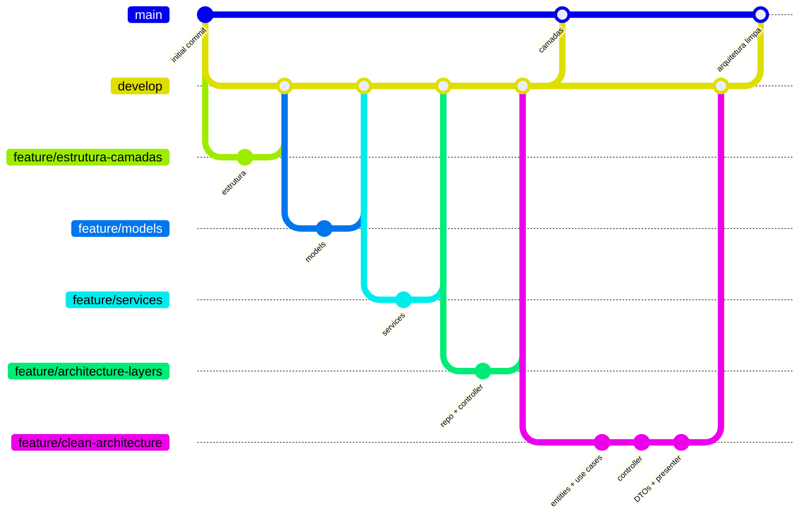

<div align="center">

# 🏷️ desconto_app

### Da Arquitetura em Camadas à Arquitetura Limpa

*Um sistema de pedidos com descontos usado como laboratório para estudar arquitetura de software, dependências e separação de responsabilidades.*


-brightgreen)


</div>

---

## 📌 Sobre o projeto

Repositório de estudos da disciplina **Alta Qualidade em Software (AQS)**, do curso de Engenharia da Computação da **Universidade SENAI CIMATEC**, ministrada pelo **Prof. Dr. Leonardo da Cruz**.

O domínio é propositalmente simples: **pedidos de clientes que recebem um desconto** conforme o tipo de cliente.

| Tipo de desconto | Percentual |
|---|:---:|
| Normal | 10% |
| VIP | 20% |
| Premium | 30% |

A regra de negócio cabe em poucas linhas. O que importa aqui é **onde cada responsabilidade mora e para que lado as dependências apontam**. O mesmo problema foi resolvido duas vezes:

1. Com **Arquitetura em Camadas** (pasta `src_antigo/`, mantida como registro).
2. Com **Arquitetura Limpa** (pasta `src/app/`, a versão atual, executada pelo `main.py`).

> **A pergunta que guiou o trabalho:**
> *Se amanhã o banco de dados, a interface ou o formato de saída mudarem, quanto da regra de negócio precisa ser reescrito?*

## 📑 Sumário

- [Como executar](#-como-executar)
- [Estrutura do projeto](#-estrutura-do-projeto)
- [Evolução do repositório](#-evolução-do-repositório)
- [Parte 1: Arquitetura em Camadas](#-parte-1-arquitetura-em-camadas)
- [Parte 2: Arquitetura Limpa](#-parte-2-arquitetura-limpa)
- [Camadas vs. Arquitetura Limpa](#%EF%B8%8F-camadas-vs-arquitetura-limpa)
- [Princípios aplicados](#-princípios-aplicados)
- [Fluxo de trabalho com Git](#-fluxo-de-trabalho-com-git)
- [Dívida técnica conhecida](#-dívida-técnica-conhecida)
- [Tecnologias](#%EF%B8%8F-tecnologias)
- [Licença](#-licença)

---

## 🚀 Como executar

**Pré-requisito:** Python 3.11. O projeto usa **apenas a biblioteca padrão**, então não há dependências para instalar.

```powershell
# 1. Clonar o repositório
git clone https://github.com/PriettoDev/desconto_app.git
cd desconto_app

# 2. (Opcional) Criar e ativar o ambiente virtual (Windows / PowerShell)
python -m venv .venv
.\.venv\Scripts\Activate.ps1

# 3. Executar (a partir da raiz do projeto)
python main.py
```

**Saída esperada:**

```text
Pedido criados: 
{'cliente': 'Cliente A', 'valor_original': 100, 'valor_desconto': 10.0, 'valor_final': 90.0, 'tipo_desconto': 'normal'}
{'cliente': 'Cliente B', 'valor_original': 200, 'valor_desconto': 40.0, 'valor_final': 160.0, 'tipo_desconto': 'VIP'}
{'cliente': 'Cliente C', 'valor_original': 300, 'valor_desconto': 90.0, 'valor_final': 210.0, 'tipo_desconto': 'Premium'}

Pedidos salvos:
{'cliente': 'Cliente A', 'valor_original': 100, 'valor_desconto': 10.0, 'valor_final': 90.0, 'tipo_desconto': 'normal'}
{'cliente': 'Cliente B', 'valor_original': 200, 'valor_desconto': 40.0, 'valor_final': 160.0, 'tipo_desconto': 'vip'}
{'cliente': 'Cliente C', 'valor_original': 300, 'valor_desconto': 90.0, 'valor_final': 210.0, 'tipo_desconto': 'premium'}
```

> [!IMPORTANT]
> Execute o `main.py` **a partir da raiz do repositório**. Os imports usam o caminho completo do pacote (`from src.app...`), que o Python só encontra quando a raiz do projeto é a pasta atual.

---

## 🗂️ Estrutura do projeto

```text
desconto_app/
├── main.py                                  # Ponto de entrada: monta as peças e executa o fluxo
├── src/
│   └── app/                                 # ✅ Arquitetura Limpa (versão atual)
│       ├── entities/
│       │   ├── desconto.py                  # IDesconto + DescontoNormal, DescontoVIP, DescontoPremium
│       │   └── pedido.py                    # Pedido: calcula desconto e valor final
│       ├── use_cases/
│       │   └── criar_pedido.py              # CriarPedido: regra da aplicação
│       ├── gateways/
│       │   └── pedido_gateway.py            # IPedidoGateway: contrato de persistência
│       ├── dtos/
│       │   ├── criar_pedido_input_dto.py    # Dados que entram no caso de uso
│       │   └── criar_pedido_output_dto.py   # Dados que saem do caso de uso
│       ├── adapters/
│       │   ├── controllers/
│       │   │   └── pedido_controller.py     # Recebe a requisição e chama o caso de uso
│       │   └── repositories/
│       │       └── memory_pedido_repository.py  # Implementa o IPedidoGateway
│       ├── presenters/
│       │   └── pedido_presenter.py          # Formata a saída para exibição
│       ├── frameworks/
│       │   └── database/
│       │       └── memory_database.py       # "Banco de dados" em memória
│       └── interfaces/                      # Pacote reservado (vazio)
├── src_antigo/                              # 📦 Arquitetura em Camadas (registro histórico)
│   ├── models/                              # Desconto e Pedido
│   ├── services/                            # PedidoService
│   ├── repositories/                        # PedidoRepository
│   ├── controllers/                         # PedidoController
│   └── database/                            # DatabaseConnection simulada
├── .gitignore
├── LICENSE
└── README.md
```

---

## 📈 Evolução do repositório

Cada etapa ficou registrada no histórico de commits, que segue o padrão **Conventional Commits** com escopo indicando a camada (`feat(entities):`, `feat(use_cases):`, `feat(controllers):`…):

| Aula | Etapa | Branch | Commits principais |
|:---:|---|---|---|
| 09 | Estrutura da arquitetura em camadas | `feature/estrutura-camadas` | `chore: cria estrutura de pacotes da arquitetura em camadas` |
| 09 | Camada de modelos | `feature/models` | `feat(models): adiciona estratégias de desconto Normal, VIP e Premium` · `feat(models): adiciona Pedido com cálculo do valor final via desconto aplicado` |
| 09 | Camada de serviços | `feature/services` | `feat(services): adiciona PedidoService para processar pedidos` |
| 09 | Repositório, banco e controller | `feature/architecture-layers` | `feat(database): ...` · `feat(repositories): ...` · `feat(controllers): ...` · `refactor(services): injeta repositório no PedidoService e conecta as camadas no main` |
| 10 | Estruturando as camadas da Arquitetura Limpa | `feature/clean-architecture` | `chore: re-arquiva arquitetura em camadas em src_antigo` · `chore: cria estrutura de pacotes da arquitetura limpa` · `feat(entities): ...` · `feat(use_cases): ...` · `feat(gateways): ...` · `feat(database): ...` |
| 11 | Fluxo até a camada de controller | `feature/clean-architecture` | `feat(repositories): ...` · `feat(controllers): adiciona PedidoController da arquitetura limpa` · `feat: conecta as camadas da arquitetura limpa no main.py` |
| 12 | Fluxo completo e chamada na main | `feature/clean-architecture` | `feat(dtos): ...` · `feat(presenters): adiciona PedidoPresenter` · `feat(arquitetura-limpa): implementa fluxo completo final com DTOs, Presenter e chamada na main` |

Para ver o histórico completo com o desenho das branches:

```bash
git log --oneline --graph --all
```

---

## 🧱 Parte 1: Arquitetura em Camadas

**Problema:** colocar toda a lógica num único arquivo mistura regra de negócio, armazenamento e apresentação. Qualquer mudança arrisca quebrar partes que não têm relação entre si.

**Solução:** dividir o sistema em camadas horizontais, cada uma com uma responsabilidade, em que cada camada só conversa com a camada logo abaixo.



| Camada | Responsabilidade |
|---|---|
| **Models** | Define os dados e as regras do domínio (`Pedido`, `IDesconto` e suas implementações). |
| **Services** | Orquestra o processamento dos pedidos. |
| **Repositories** | Define como o sistema salva e recupera informações, sem se preocupar com o banco específico. |
| **Database** | Infraestrutura: a conexão com o "banco" (aqui, uma lista em memória). |
| **Controllers** | Recebe as requisições e repassa para o serviço. |

**Limitação percebida:** as dependências apontam **de cima para baixo**, e a regra de negócio fica acima da infraestrutura, dependendo dela. Trocar o banco ou a forma de armazenar ainda pode respingar nas camadas superiores.

---

## 🎯 Parte 2: Arquitetura Limpa

**Ideia central (a Regra de Dependência):** o código-fonte só pode depender **para dentro**, em direção às regras de negócio. As entidades e os casos de uso não sabem que existe banco de dados, controller ou forma de exibição.



### O caminho de um pedido



### O papel de cada peça

| Camada | Peça | Responsabilidade |
|---|---|---|
| 💎 **Entidades** | `Pedido`, `IDesconto` | As regras de negócio mais estáveis: como calcular desconto e valor final. Não dependem de nada externo. |
| ⚙️ **Casos de uso** | `CriarPedido` | A regra da aplicação: escolhe o desconto pelo tipo, cria o pedido e pede para salvá-lo. |
| ⚙️ **Casos de uso** | `IPedidoGateway` | O **contrato** de persistência, definido do lado de dentro. O caso de uso depende da interface, não do banco. |
| ⚙️ **Casos de uso** | `CriarPedidoInputDTO`, `CriarPedidoOutputDTO` | Objetos simples que carregam dados para dentro e para fora do caso de uso, sem expor as entidades. |
| 🔌 **Adaptadores** | `PedidoController` | Converte a chamada externa em um DTO de entrada e aciona o caso de uso. |
| 🔌 **Adaptadores** | `MemoryPedidoRepository` | **Implementa** o `IPedidoGateway` usando o banco em memória. |
| 🔌 **Adaptadores** | `PedidoPresenter` | Transforma o DTO de saída no formato de exibição (dicionário). |
| 🌐 **Frameworks** | `MemoryDatabase` | O detalhe técnico de armazenamento. Pode ser trocado sem tocar nas regras. |
| 🌐 **Frameworks** | `main.py` | O ponto de montagem: cria as peças e injeta uma na outra. |

> 💡 **Aprendizado:** a pasta onde o arquivo está não define a arquitetura. O que define é **para onde apontam os imports**. Em `src/app/`, o caso de uso conhece apenas a interface `IPedidoGateway`. Quem conhece o banco é o repositório, que fica do lado de fora.

---

## ⚖️ Camadas vs. Arquitetura Limpa

| Aspecto | Arquitetura em Camadas (`src_antigo/`) | Arquitetura Limpa (`src/app/`) |
|---|---|---|
| Direção das dependências | De cima para baixo, até a infraestrutura | Sempre para dentro, em direção às regras de negócio |
| Quem define o contrato de persistência | A própria camada de repositório | O núcleo (`IPedidoGateway`); a infraestrutura se adapta |
| Trocar o banco de dados | Pode exigir mudanças nas camadas de cima | Basta uma nova classe que implemente `IPedidoGateway` |
| Formato de saída | Misturado com o processamento (`print` no serviço) | Isolado no `PedidoPresenter` |
| Testar a regra de negócio isolada | Depende de montar serviço e repositório | Casos de uso recebem dublês do gateway com facilidade |
| Custo | Menos arquivos, mais simples de começar | Mais peças e mais código de "cola" |

> 💡 **Trade-off:** para um domínio deste tamanho, a Arquitetura Limpa é claramente mais estrutura do que o problema exige. O objetivo aqui foi **didático**: exercitar a Regra de Dependência num cenário pequeno, para reconhecê-la depois em sistemas grandes, onde ela realmente compensa.

---

## 🧭 Princípios aplicados

| Princípio | Onde aparece |
|---|---|
| **SRP** (Responsabilidade Única) | Cada classe tem um motivo para mudar: o controller recebe, o caso de uso decide, o repositório guarda, o presenter formata. |
| **OCP** (Aberto/Fechado) | Novos descontos são criados como novas subclasses de `IDesconto`, sem alterar o `Pedido`. |
| **LSP** (Substituição de Liskov) | Qualquer implementação de `IDesconto` pode substituir outra sem quebrar o cálculo do `Pedido`. |
| **DIP** (Inversão de Dependência) | `CriarPedido` depende da abstração `IPedidoGateway`, e não do `MemoryPedidoRepository`. |
| **Injeção de dependência** | O `main.py` cria as peças e as passa pelos construtores: `MemoryDatabase` → `MemoryPedidoRepository` → `CriarPedido` → `PedidoController`. |

---

## 🌿 Fluxo de trabalho com Git

O repositório seguiu o **Git Flow** visto em aula:



| Branch | Papel | Vida útil |
|---|---|---|
| `main` | Versões estáveis e completas de cada arquitetura | Permanente |
| `develop` | Integração das funcionalidades | Permanente |
| `feature/*` | Uma etapa de cada aula | Integrada na `develop` e encerrada |

**Práticas exercitadas:** uma branch por etapa, merges com `--no-ff` para preservar o desenho do histórico, commits atômicos com Conventional Commits e escopo por camada, e revisão com `git status` e `git diff` antes de cada commit.

---

## 🧾 Dívida técnica conhecida

Pontos identificados e registrados conscientemente, que ficaram para trabalhos futuros:

- [ ] **`src_antigo/` não é executável diretamente:** ao ser arquivada, a pasta manteve os imports com o caminho antigo (`from src.models...`). Ela serve como registro da arquitetura em camadas, cuja versão executável está preservada no histórico de commits.
- [ ] **Diferença de maiúsculas na saída:** em "Pedidos criados" o tipo aparece como foi digitado (`VIP`), e em "Pedidos salvos" aparece normalizado (`vip`), porque o `CriarPedido` devolve o valor original no DTO e salva o valor normalizado.
- [ ] **Type hint impreciso:** `IPedidoGateway.listar()` declara `list[Pedido]`, mas o repositório devolve uma lista de dicionários com o pedido e o tipo de desconto.
- [ ] **Escolha do desconto com `if/elif`** no `CriarPedido`: um novo tipo exige alterar o caso de uso. Um dicionário de estratégias ou uma fábrica resolveria isso respeitando o OCP.
- [ ] **Sem testes automatizados:** a estrutura com interfaces e injeção de dependência já permite testar `CriarPedido` com um dublê de `IPedidoGateway`.

---

## 🛠️ Tecnologias

| Ferramenta | Versão | Uso |
|---|---|---|
| Python | 3.11 | Linguagem |
| `abc` (biblioteca padrão) | — | Classes abstratas (`IDesconto`, `IPedidoGateway`) |
| Git + GitHub | — | Versionamento e Git Flow |

---

## 📄 Licença

Distribuído sob a licença **MIT**. Veja o arquivo [`LICENSE`](LICENSE).

<div align="center">

Desenvolvido por **Prietto** ([@PriettoDev](https://github.com/PriettoDev)) como parte da disciplina **Alta Qualidade em Software**, Universidade SENAI CIMATEC.

</div>
